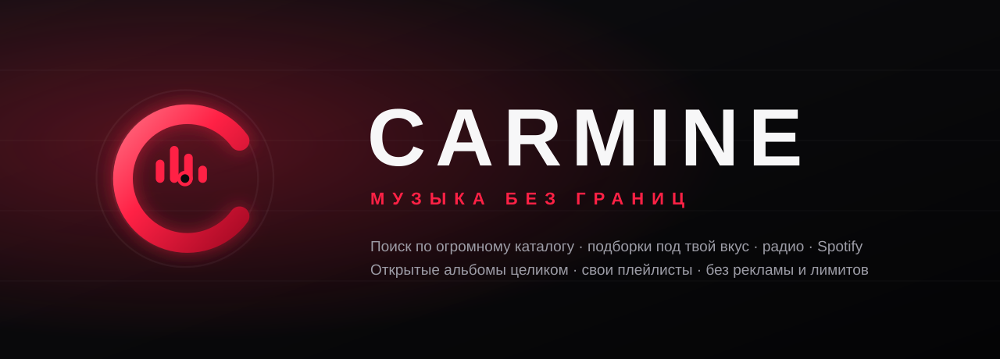

# CARMINE

**Бесплатный музыкальный плеер без рекламы, подписок и лимитов.**
Чёрно-красный характер, поиск по огромному каталогу, подборки под твой вкус, полные альбомы из открытых библиотек, живое радио и официальная интеграция со Spotify.

[](https://github.com/orlovga56-sudo/carmine/actions/workflows/deploy.yml)
[](LICENSE)


Открыть приложение: **https://orlovga56-sudo.github.io/carmine/**

---

## Честно о Spotify

«Вся музыка Spotify бесплатно» — это обход DRM и лицензий. Такой код незаконен, а сервис живёт ровно до первого письма юристов. Carmine делает **легальную** версию мечты:

| Что хотелось | Что есть в Carmine |
| --- | --- |
| Огромный каталог | Официальный Apple iTunes API: треки, альбомы, артисты, чарты |
| Слушать всё целиком | Полные альбомы из Internet Archive (свободные лицензии), живое радио, свои файлы |
| «Моя музыка» из Spotify | Вход через свой аккаунт (OAuth PKCE), импорт лайков и плейлистов, Web Playback SDK |
| Без рекламы и лимитов | Ни рекламы, ни аккаунта, ни подписки. Всё хранится в браузере |
| Интерфейс как у Spotify | Похожая логика, но свой чёрно-красный дизайн |

Полное воспроизведение Spotify требует **Premium** — это ограничение самого Spotify, а не приложения. Для бесплатных аккаунтов работают 30-секундные официальные превью.

## Возможности

- **Главная** — hero-микс, подборки «Для тебя» на основе лайков и истории, чарты, новые альбомы, жанры.
- **Поиск** — треки, альбомы и артисты с обложками; недавние запросы; запуск жанра одним кликом.
- **Плеер** — очередь, перемешивание, повтор, громкость, seek, горячие клавиши, Media Session (управление с клавиатуры/медиа-клавиш).
- **Любимые треки и плейлисты** — свои коллекции, обложки, переименование, экспорт/импорт JSON.
- **Радио** — тысячи станций из открытого каталога radio-browser.info, бесконечный эфир.
- **Открытая сцена** — целые альбомы netlabels и независимых артистов с Internet Archive.
- **Spotify** — OAuth PKCE, импорт лайков/плейлистов, Web Playback SDK для Premium.
- **Настройки** — регион каталога, акцентный цвет, автопереход, резервные копии.
- **PWA** — ставится на телефон и десктоп, работает как отдельное приложение.
- **Адаптивность** — десктопный сайдбар и мобильная нижняя навигация.

## Стек

React 18 · TypeScript · Vite 6 · чистый CSS (без UI-фреймворков) · lucide-react · GitHub Pages + Actions.

## Запуск

```bash
npm install
npm run dev      # http://localhost:5173
npm run build    # production-сборка в dist/
npm run preview  # посмотреть сборку
```

Требуется Node 20+.

## Подключение Spotify

1. Создай приложение на [developer.spotify.com/dashboard](https://developer.spotify.com/dashboard).
2. Добавь Redirect URI — приложение покажет его на странице **Spotify** (для локальной разработки это `http://localhost:5173/`, для GitHub Pages — `https://orlovga56-sudo.github.io/carmine/`).
3. Скопируй **Client ID** и вставь его на странице Spotify или в настройках.
4. Нажми «Войти через Spotify». Пароль вводится только на стороне Spotify — приложение его не видит.

Токены хранятся в `localStorage` твоего браузера. Никакого бэкенда и сбора данных нет.

## Источники музыки

| Источник | Что даёт | Ключ |
| --- | --- | --- |
| Apple iTunes Search / RSS | Каталог, обложки, чарты, 30-секундные превью | не нужен |
| Internet Archive | Полные альбомы со свободной лицензией | не нужен |
| radio-browser.info | Прямые эфиры радиостанций | не нужен |
| Spotify Web API + SDK | Своя библиотека, полное воспроизведение (Premium) | Client ID пользователя |

## Горячие клавиши

| Клавиша | Действие |
| --- | --- |
| `Space` | Play / Pause |
| `←` / `→` | −5 / +5 секунд |
| `Ctrl + ←` / `Ctrl + →` | Предыдущий / следующий трек |
| `M` | Выключить звук |
| `L` | Лайк текущего трека |
| `Ctrl + K` | Фокус на поиск |

## Структура

```
src/
  components/   Сайдбар, топбар, плеер, карточки, строки треков, тосты
  lib/          iTunes, Spotify (PKCE + SDK), Internet Archive, радио, роутер, кэш
  pages/        Главная, поиск, альбом, артист, плейлист, радио, Spotify, настройки
  store.tsx     Лайки, плейлисты, история, настройки (localStorage)
  player.tsx    Аудиодвижок, очередь, Media Session, Spotify SDK
```

## Лицензия

Код — [MIT](LICENSE). Музыка принадлежит её авторам и распространяется на условиях соответствующих источников.
